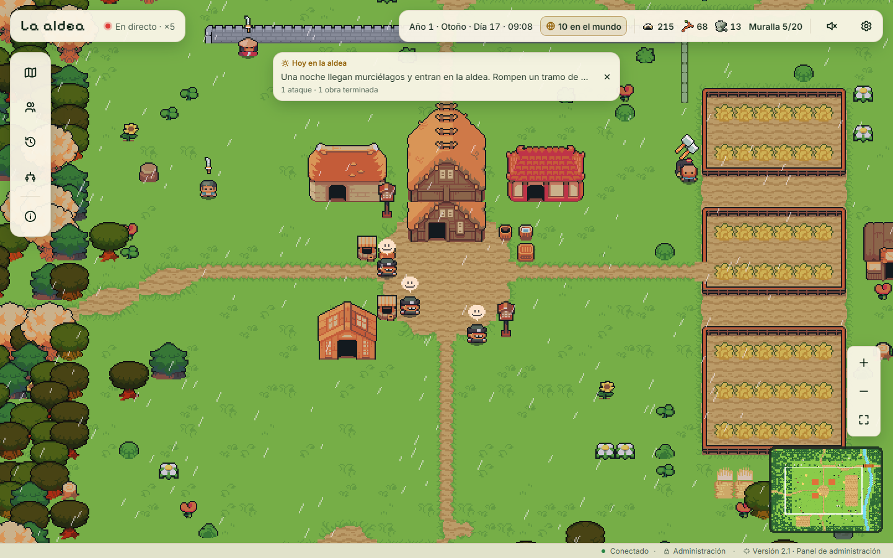
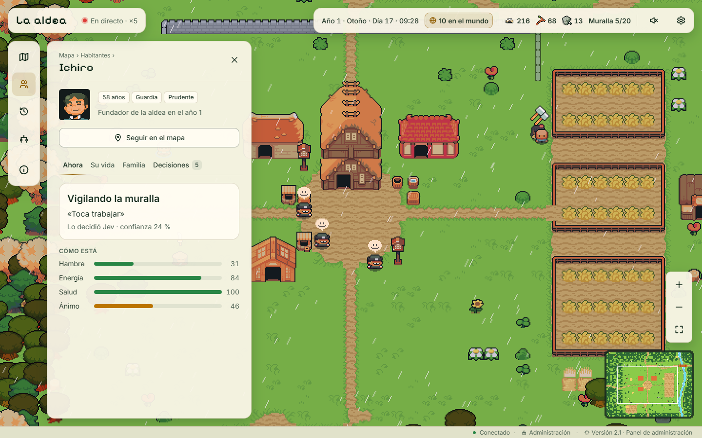
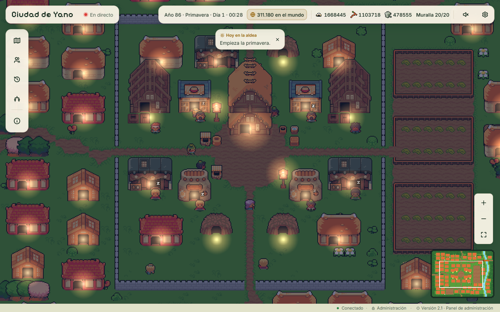
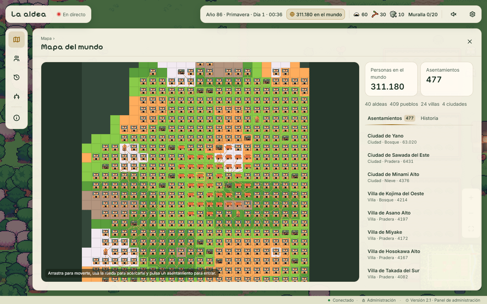
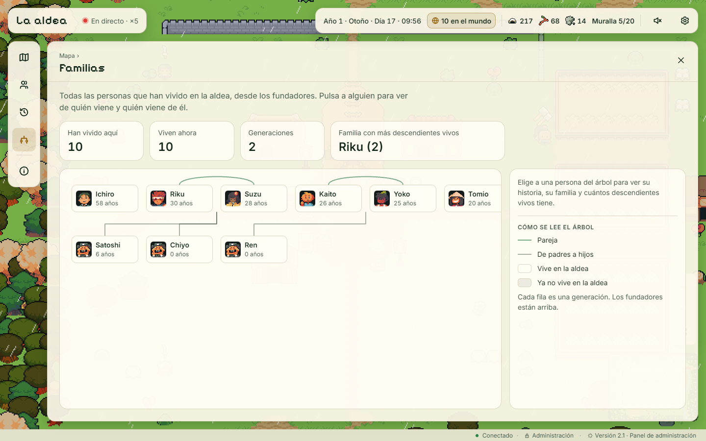
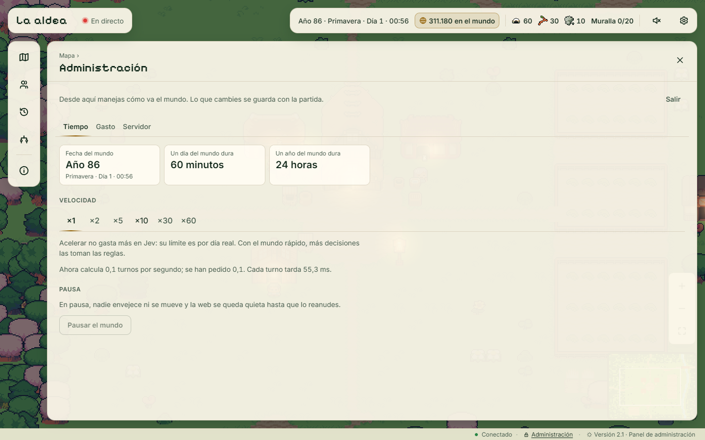

<div align="center">

# The Village · La aldea

A test bench for **Jev**, the OpenRouter decision model.<br>
Every villager decides their life with Jev. You watch it live in the browser.

**English** · [Español](README.es.md)

[](web/src/versiones.js)
[](https://openrouter.ai)
[](https://www.python.org)
[](https://fastapi.tiangolo.com)
[](https://vuejs.org)
[](https://pixijs.com)
[](#with-docker)
[](LICENSE)
[](https://github.com/Dasge97/the-village/commits/main)



[](https://aldea.code-hive.space)
&nbsp;
[](#installation)
&nbsp;
[](#how-it-works)

</div>

## What it is for

> **The first goal of this project is to test what Jev can do.**

Jev (`typesafe/jev-1.14`) is an OpenRouter model that does not write text: it receives a
situation and a list of options, and returns the chosen option, the probability of each one and
its confidence. This project puts it to the test on a case that is hard and easy to watch:
deciding, again and again, the lives of people who get hungry and tired, have a personality, a
family, and monsters to fear.

The questions it tries to answer:

- Does Jev make sensible decisions when the situation keeps changing?
- Does each villager's personality (lazy, brave, sociable…) show in what Jev picks?
- Can a village survive in the long run on its decisions alone?
- How much does it cost, and how long does it take, with thousands of decisions a day?

The second goal is to watch a whole world grow with nothing scripted in advance: from a village
of 8 people to towns, large towns and cities with hundreds of thousands of inhabitants.

The interface and the game texts are in Spanish.

## What it does

- **A village that lives on its own**, turn by turn, around the clock. Villagers work, eat, sleep,
  make friends, pair up, have children, grow old and die.
- **Jev decides** what each adult does for the next two hours. Each villager's sheet shows the
  decision, the reason and Jev's confidence. Urgent needs (eating when very hungry, sleeping when
  out of energy) are handled by fixed rules.
- **The world grows:** when a village is full, someone leaves and founds another. Several villages
  give rise to a town (*pueblo*), several towns to a large town (*villa*), several large towns to
  a city (*ciudad*). Their councils also decide with Jev.
- **Dangers and life:** monster attacks you can see on the map, spreading epidemics, fires, trade
  caravans, weather and seasons.
- **Everything live on the web:** pixel-art map, a sheet for every villager, family tree, history
  year by year, and a world map with every settlement.
- **Controlled spending:** Jev has a daily dollar limit. When it runs out, the rules decide and
  the villager's sheet says so.
- **Installable as an app** on phones and desktops, with its own icon.
- **Admin panel** behind a password: speed up or pause the world, see Jev's spending and change
  its limit.

<div align="center">
<table>
<tr>
<td align="center"><br><sub>A villager's sheet: what they do and why Jev chose it</sub></td>
<td align="center"><br><sub>A city of 63,000 people, at night</sub></td>
</tr>
<tr>
<td align="center"><br><sub>World map</sub></td>
<td align="center"><br><sub>World history and great moments</sub></td>
</tr>
<tr>
<td align="center"><br><sub>Family tree</sub></td>
<td align="center"><br><sub>Admin panel</sub></td>
</tr>
</table>
</div>

## Installation

You need Python 3.14 and Node.js 24.

```bash
git clone https://github.com/Dasge97/the-village.git
cd the-village

python -m venv .venv
.venv/bin/pip install -r requirements.txt        # on Windows: .venv\Scripts\pip

cd web && npm ci && npm run build && cd ..
```

### Run without Jev

The rules decide. No key is needed and nothing is spent.

```bash
.venv/bin/python -m jevmura.servidor
```

Open <http://localhost:8000>.

### Run with Jev

You need an [OpenRouter](https://openrouter.ai) key.

```bash
export OPENROUTER_API_KEY=...       # in PowerShell: $env:OPENROUTER_API_KEY = "..."
export ALDEA_ADMIN_CLAVE=...        # optional: admin panel password
.venv/bin/python -m jevmura.servidor --jev
```

### With Docker

```bash
cp secrets.env.example secrets.env      # and fill in the values
docker compose -f docker-compose.production.yml up -d --build
```

The Compose file publishes no port, so you can put it behind your own proxy. To try it on your
machine, create a `docker-compose.override.yml` with this and add it with another `-f`:

```yaml
services:
  app:
    ports:
      - "8000:8000"
```

The world data is kept in the `aldea_datos` volume.

## Usage

The web is for watching only: the world moves on by itself and nobody steers it.

| Where | What you see |
|---|---|
| Map | The village live. Click someone to open their sheet; drag and use the wheel to move around |
| Habitantes | Who lives there and what they are doing. In towns and cities, their figures and notables |
| Historia | What has happened, day by day, and, maximized, the history year by year |
| Familias | The family tree of everyone who has lived there |
| Mapa del mundo | Every settlement, the world history and its great moments |
| Name at the top left | Switch settlement |
| Administración (bottom bar) | Speed, pause, Jev spending and server status |

Screens are in the address (`#/habitantes/12`, `#/mundo/historia`, `#/?aldea=5`), so they can be
reloaded and shared.

## Configuration

| Variable | What for | Default |
|---|---|---|
| `OPENROUTER_API_KEY` | OpenRouter key for Jev | — |
| `ALDEA_ADMIN_CLAVE` | Admin panel password. Empty: panel closed | — |
| `JEVMURA_JEV` | `1` to decide with Jev (same as `--jev`) | off |
| `JEVMURA_DB` | Where the world is saved | `datos/mundo.db` |
| `JEVMURA_SEMILLA` | Seed for the map and randomness when a new world is created | `0` |
| `JEVMURA_HORA_INICIAL` | World hour at which a new world starts | `7` |

Options of `python -m jevmura.servidor`: `--db`, `--semilla`, `--jev`, `--puerto` (8000) and
`--rapido <seconds per turn>` for testing.

From the admin panel you can change these, and they are saved with the game:

| Setting | Values |
|---|---|
| Speed | ×1 (one turn every 10 s, one world year per real day), ×2, ×5, ×10, ×30, ×60 |
| Pause | Yes or no |
| Jev limit | Dollars per day (0.30 at start): 60 % for villagers, 40 % for councils |
| Jev | On or off |

## How it works

```
 browser (Vue + PixiJS)  ◄── websocket: state after every turn ──  server (FastAPI)
                                                                       │
                                       world thread: one turn every 10 s
                                       ├─ villages: every person, with a name and needs
                                       │    └─ decision? → Jev (if budget is left) or rules
                                       ├─ towns, large towns and cities: people by age + notables
                                       │    └─ council every season → Jev or rules
                                       └─ world: foundations, moves, caravans, epidemics
                                                  │
                                            SQLite (one database per village + mundo-global.db)
```

- **Decisions:** for each adult, the engine works out the possible options and what each one
  achieves. It sends them to Jev with the villager's situation (needs, personality, relationships,
  what the village lacks). Jev chooses; the engine carries it out. If Jev fails, is slow or the
  budget is used up, a rule-based decider takes over and the world never stops.
- **Time:** one turn is 10 real seconds. A world day lasts one hour and a world year, one real day.
- **Three levels of detail:** in villages every person is simulated. In towns and cities people
  are simulated by age, with resources and buildings, and only the notables have a name.
- **Budget:** two buckets of calls that refill slowly over the day. The village someone is
  watching gets priority.
- **Growth:** tuned to reach half a million people in about 90 world years. It is checked with
  the fast simulation:

```bash
.venv/bin/python -m jevmura.mundo.simular 90 2026      # years, seed and, optionally, a folder to save it
```

The full design, with every rule and decision, is in [docs/proyecto.md](docs/proyecto.md) (in
Spanish). The changes in each version are in [web/src/versiones.js](web/src/versiones.js).

### Tests

```bash
.venv/bin/pip install -r requirements-dev.txt
.venv/bin/python -m pytest
```

## License

The code is under the [MIT](LICENSE) license.

The graphics and sounds in `web/public/sprites` come from the
[Ninja Adventure](https://pixel-boy.itch.io/ninja-adventure-asset-pack) pack by Pixel-boy and AAA,
under the [CC0](web/public/sprites/LICENSE.txt) license.
